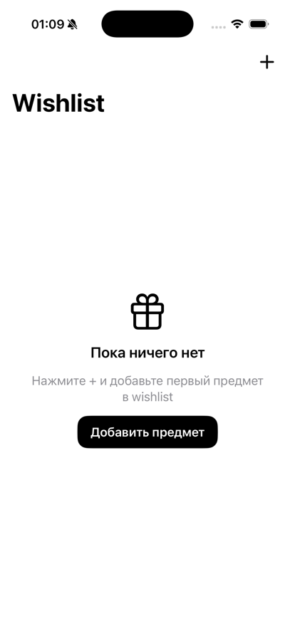

# Wishlist

An iOS app for a personal wish list: an item, photos, a price and a "bought" mark.

[Русский](README.md) · **English**

<p align="center">
  
  &nbsp;
  
  &nbsp;
  
</p>

## Why

Wishes usually end up scattered across notes, screenshots and shop bookmarks.
Here everything is in one place, with photos and prices, and you can see what
you have already saved up for. The data stays on the phone: no accounts and
no network.

## Features

- cards with a title, price, description and a photo gallery
- any number of photos per item through the system `PhotosPicker`
- a "bought" mark, editing and deleting from the card menu
- data survives restarts: JSON and image files in `Documents`
- an animated launch screen

## Stack

Swift · SwiftUI · PhotosUI · no third-party dependencies · iOS 17+

## Structure

```
Wishlist/
  App/        entry point and launch screen
  Models/     WishlistItem, ItemPhoto
  Store/      WishlistStore (list + JSON), ImageStore (files + cache)
  Views/      screens, card, palette
  Resources/  assets
```

## Run

```bash
git clone https://github.com/te1pe/wishlist-ios.git
open wishlist-ios/Wishlist.xcodeproj
```

Then pick a simulator in Xcode and press Run.
