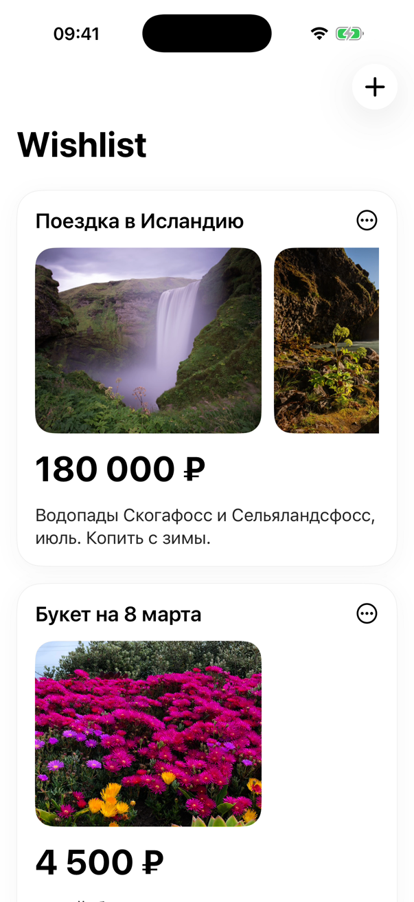
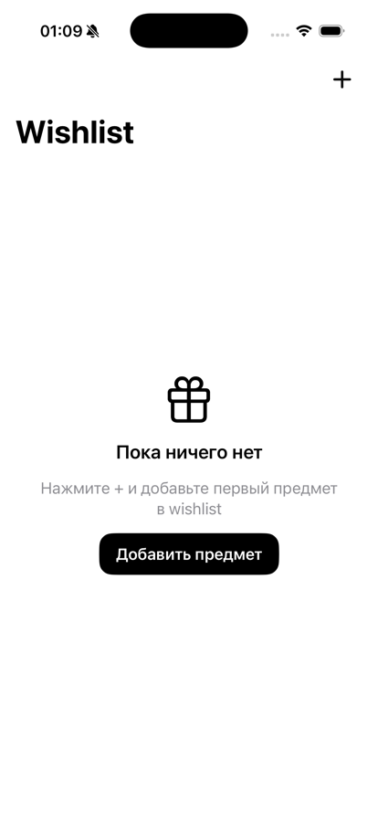

# Wishlist

iOS-приложение для личного списка желаний: вещь, фото, цена и отметка «куплено».

**Русский** · [English](README.en.md)

<p align="center">
  
  &nbsp;
  
  &nbsp;
  
</p>

## Зачем

Хотелки обычно разбросаны по заметкам, скриншотам и закладкам в магазинах.
Здесь всё в одном месте, с фотографиями и ценой, и видно, на что уже
накопил. Данные остаются на телефоне: без аккаунтов и без сети.

## Что умеет

- карточки с названием, ценой, описанием и галереей фото
- сколько угодно фото на вещь через системный `PhotosPicker`
- отметка «куплено», редактирование и удаление из меню карточки
- данные переживают перезапуск: JSON и файлы картинок в `Documents`
- анимированная заставка при запуске

## Стек

Swift · SwiftUI · PhotosUI · без сторонних зависимостей · iOS 17+

## Структура

```
Wishlist/
  App/        точка входа и заставка
  Models/     WishlistItem, ItemPhoto
  Store/      WishlistStore (список + JSON), ImageStore (файлы + кэш)
  Views/      экраны, карточка, палитра
  Resources/  ассеты
```

## Запуск

```bash
git clone https://github.com/te1pe/wishlist-ios.git
open wishlist-ios/Wishlist.xcodeproj
```

Дальше в Xcode выбрать симулятор и нажать Run.
